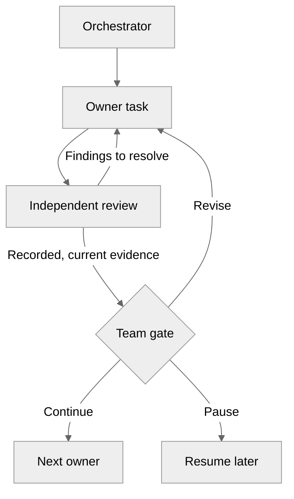

> **Print this page** (Ctrl+P → Save as PDF or print double-sided). Optimized for A4 paper and narrow screens.

---

## Key Actions at a Glance

1. **Before the event** → Run the [Participation Gate](../../getting-started/setup/#participation-gate)
2. **First 10 minutes** → Open the Dev Container; check the Copilot session target, permitted model, agents, tools, and root `.mcp.json`
3. **APEX stages** → Use the Orchestrator or a direct owner, inspect required independent reviews, and approve the stage
4. **End of day** → Team lead confirms the authorized cleanup scope, deletes resources, and verifies cleanup

---

## Hackathon Schedule (1 Day)

| Time        | Challenge       | Duration | Points |
| ----------- | --------------- | -------- | ------ |
| 09:00-10:00 | Intro           | 60 min   | —      |
| 10:00-11:00 | **Challenge 1** | 60 min   | 20     |
| 11:00-12:00 | **Challenge 2** | 60 min   | 25     |
| 12:00-12:45 | 🍽️ Lunch        | 45 min   | —      |
| 12:45-13:30 | **Challenge 3** | 45 min   | 25     |
| 13:30-14:15 | **Challenge 4** | 45 min   | 10     |
| 14:15-14:30 | Checkpoint      | 15 min   | —      |
| 14:30-15:00 | **Challenge 5** | 30 min   | 5      |
| 15:00-15:15 | ☕ Break        | 15 min   | —      |
| 15:15-15:30 | **Challenge 6** | 15 min   | 5      |
| 15:30-15:35 | **Challenge 7** | 5 min    | 5      |
| 15:35-15:50 | Prep            | 15 min   | —      |
| 15:50-16:50 | **Challenge 8** | 60 min   | 10     |
| 16:50-17:00 | Wrap-up         | 10 min   | —      |

**Total Points**: 105 base + 25 bonus

## Scoring & Leaderboard

| Method              | How                                                                                              |
| ------------------- | ------------------------------------------------------------------------------------------------ |
| **Rubric scoring**  | All scoring is manual. Facilitators review artifacts and verify deployments against the rubric.   |
| **Leaderboard**     | Use your facilitator worksheet or HackerBoard instance if your event package includes one         |
| **Tooling**         | Optional: record rubric-based totals in HackerBoard when that tooling is available (it does not calculate scores automatically) |
| **Rubric**          | Scoring Rubric (available from facilitator) — single source of truth for points |

---

## Keyboard Shortcuts

| Shortcut       | Action                        |
| -------------- | ----------------------------- |
| `Ctrl+Alt+I`   | Open Chat view                |
| `Ctrl+Shift+I` | Switch to Agent mode          |
| `Ctrl+I`       | Inline chat (editor/terminal) |
| `Ctrl+N`       | New chat session              |
| `Ctrl+Alt+.`   | Model picker                  |
| `Tab`          | Accept suggestion             |
| `Escape`       | Dismiss suggestion            |

---

## Custom Agents

In VS Code, choose the **Copilot** session target separately from the model. Start with `01-Orchestrator` for bounded native delegation, or select a domain owner directly. The team still makes stage decisions and separately authorizes deployment.

| Agent | Purpose | Challenges |
| --- | --- | --- |
| **01-Orchestrator** | Coordinate authorized owner tasks, gates, and recovery | All, optional entry point |
| **02-Requirements** | Capture requirements and initial SKU evidence | 1, 4 revision |
| **03-Architect** | Assess architecture and cost feasibility | 2, 4 revision |
| **04-Design** | Create optional diagrams and ADRs | 2, 4 |
| **04g-Governance** | Discover and reconcile effective Azure Policy constraints | 3, 4 revision |
| **05-IaC Planner** | Create the implementation plan and contracts | 3, 4 revision |
| **06b-Bicep CodeGen** | Generate the approved Bicep track | 3, 4 |
| **06t-Terraform CodeGen** | Generate the approved Terraform track | 3, 4 |
| **07b-Bicep Deploy** | Deploy the authorized Bicep scope | 3, 4 |
| **07t-Terraform Deploy** | Deploy the authorized Terraform scope | 3, 4 |
| **08-As-Built** | Generate requested documentation from actual evidence | 6 |
| **09-Diagnose** | Investigate a confirmed scope and symptom; optional for the card | 7 |
| **10-Challenger** | Optional interactive review and authorized fixes | 1-4 |
| **11-Context Optimizer** | Audit Copilot context usage and recommend improvements; reference-only | — |

The reviewed agent definitions do not pin models. Check that the selected runtime, organization-permitted model, agents, and declared tools are available. The Context Optimizer is reference-only and does not replace an owner or a human approval gate.

**How to use**: `Ctrl+Alt+I` → choose the Copilot target and `01-Orchestrator` or a direct owner → provide current artifacts and scope → inspect actual recorded review findings → resolve blockers → decide the stage gate. Required reviews use the independent `challenger-review-subagent`; Architecture and cost have separate lenses.

**Continue or pause**: Approve and continue dispatches the next named owner in the same chat; approve and pause saves recovery context. Resume with `/apex-workflow-start resume freshconnect`. Missing or stale review evidence blocks the affected gate; preflight or a chat response alone is not a review receipt. New projects use `practical-v1`; existing projects remain legacy until owner-approved adoption.

**Recovery vs. deployment**: `00-handoff.md` is a recovery summary, not approval. `05-iac-handoff.json` remains the CodeGen-to-Deploy artifact. Before deployment, separately approve the current preview and exact tenant, subscription, target, and operation.

---

## Chat Features

| Feature             | How to Use                                 |
| ------------------- | ------------------------------------------ |
| **Context**         | `#file`, `#folder`, `#symbol`, drag & drop |
| **Codebase search** | `#codebase` in prompt                      |
| **Fetch web page**  | `#fetch url`                               |
| **Workspace**       | `@workspace` for workspace questions       |
| **Terminal**        | `@terminal` for shell help                 |
| **Slash commands**  | `/fix`, `/explain`, `/tests`, `/doc`       |

---

## Essential CLI Commands

Participant deployment is agent-owned. Use the approved `07b-Bicep Deploy` or
`07t-Terraform Deploy` owner, directly or through Orchestrator, after the team reviews
current validation and separately authorizes the current preview and exact scope.
Participants can use the read-only and local validation examples below. Resource
creation and direct deployment commands are for facilitators; the team lead owns
cleanup. Each consequential action requires authorization for its exact scope.

```bash
az account show --query name -o tsv
bicep --version

# Facilitator only: create a resource group after scoped authorization
az group create -n rg-freshconnect-dev-swc -l swedencentral

# Validate Bicep
bicep build main.bicep
bicep lint main.bicep

# Facilitator diagnostic example: What-If
az deployment group what-if -g rg-freshconnect-dev-swc -f main.bicep

# Facilitator only: deployment after preview and separate scoped authorization
az deployment group create -g rg-freshconnect-dev-swc -f main.bicep

# Cleanup (END OF DAY — team lead confirms the authorized scope!)
az group delete -n rg-freshconnect-dev-swc --yes --no-wait
az group delete -n rg-freshconnect-dev-gwc --yes --no-wait  # if secondary region was used
# Verify cleanup:
az group list --query "[?starts_with(name, 'rg-freshconnect')]" -o table
```

Ask your facilitator to remove governance policies only within the approved cleanup scope.

---

## Bonus Targets (+25 max)

| Enhancement | Points | What to prove |
| ----------- | ------ | ------------- |
| Zone Redundancy | +5 | Supported SKU with zone redundancy enabled |
| Private Endpoints | +5 | Private connectivity for the relevant services |
| Multi-Region DR | +10 | Resources deployed in 2+ regions |
| Managed Identities | +5 | Identity-based access with no hard-coded connection strings |

---

## Expected Outputs

| Challenge | Input evidence | Output evidence | Next action |
| --- | --- | --- | --- |
| 1 | Scenario brief | Requirements, SKU manifest, requirements review findings, approval | C2: Architecture |
| 2 | Approved C1 evidence | Architecture, current `COMPLETE` pricing JSON, `03-des-cost-estimate.md`, separate reviews, approval, optional design artifacts | C3: Implementation |
| 3 | Approved C1-C2 evidence | Governance constraints, approved plan and contracts, `05-iac-handoff.json`, validation, deployment summary, workflow diagram | C4: DR curveball |
| 4 | C3 evidence and changed requirement | Revised affected artifacts, reviews and approvals, ADR, updated IaC or paper design, updated cost and diagram | C5: Load test |
| 5 | Deployed endpoint or fallback plan | `agent-output/freshconnect/05-load-test-results.md` | C6: Documentation |
| 6 | Prior artifacts and available observations | `agent-output/freshconnect/07-operations-runbook.md` plus one `07-*.md` document; request both as planned-only drafts if deployment is missing, failed, or unaccepted | C7: Diagnostics |
| 7 | Platform evidence and docs | `agent-output/freshconnect/07-diagnostics-quick-card.md`; optional separate `agent-output/freshconnect/08-resource-health-report.md` | C8: Showcase |
| 8 | All prior artifacts, reviews, approvals, and evidence | Live presentation and Q&A | Wrap-up |

## Artifact Handoff Contract

- Check the required inputs and current review evidence before continuing with an owner.
- Save each artifact at the expected path and keep machine-readable sidecars with their Markdown artifact.
- For pricing, `02-cost-estimate.json` is the initial target; a current registered, validated `COMPLETE` versioned result is valid without an unversioned alias. Record source, currency, usage, and conversion assumptions.
- Resolve blocking independent findings and verify fresh recorded evidence before approval.
- Reopen affected work after material changes; preserve review history and obtain the required renewed approvals.
- Keep validation and previews separate from scoped deployment authorization.
- Name assumptions, failures, and verification limits clearly.
- Leave usable evidence for the next challenge, not a successful-looking chat response alone.

## Prompt Recipe

Use this short recipe when a challenge page tells you to prompt an agent:

```text
Goal: [artifact or decision]
Context: [FreshConnect facts + prior artifact path]
Decisions now: [2-4 key trade-offs]
Return: [file name, format, and evidence required]
```

## Mermaid & ADR Conventions

- Mermaid diagrams should show the services, data flow, boundaries, and failure or
  handoff path that matters for the challenge.
- C3 Mermaid workflow diagrams should show delegation, independent review, team gates, and return paths.
- Optional rendered Azure architecture diagrams use `apex-python-diagrams` with `.py`, editable `.svg`, and `.png` outputs; they are distinct from the Mermaid workflow.
- ADRs should always cover `Context`, `Decision`, `Consequences`, and `Alternatives`.
- Keep diagrams readable enough to present in Challenge 8 without rework.

## Paper Exercise Rules

- Use the paper path only when deployment is genuinely blocked.
- Keep the same output artifact names where possible.
- Record the blocker, intended change, and expected outcome.
- Do not present design intent as deployed evidence.

---

## Pro Tips

**Challenge 3 — Mermaid Flowcharts:**

````markdown

````

Deployment still requires a current preview and separate scoped authorization.

**Challenge 4 — ADR Template:**

```markdown
# ADR: Multi-Region Disaster Recovery

## Context

[Why DR is needed now]

## Decision

[What approach we chose]

## Consequences

[Cost, complexity, benefits]
```

**Challenge 6 — Documentation Prompts:**

- "Generate ops runbook for [audience]"
- "Create cost breakdown with optimization tips"
- "Document DR procedures for compliance audit"

**Challenge 7 — Diagnostic Queries:**

Use these read-only examples only for a confirmed target and authorized read scope.

```bash
# Quick health check
az webapp show --name <app-name> --resource-group <rg> --query state

# Application Insights query
az monitor app-insights query --app <app-id> \
  --analytics-query "requests | where timestamp > ago(1h) | summarize avg(duration)"
```

---

## Naming Conventions

| Resource    | Pattern                        | Max |
| ----------- | ------------------------------ | --- |
| Key Vault   | `kv-{project}-{env}-{suffix}`  | 24  |
| Storage     | `st{project}{env}{suffix}`     | 24  |
| SQL Server  | `sql-{project}-{env}-{suffix}` | 63  |
| App Service | `app-{project}-{env}-{region}` | 60  |

**Generate unique suffix**:

```bicep
var uniqueSuffix = uniqueString(resourceGroup().id)
```

---

## Security Checklist

- [ ] `supportsHttpsTrafficOnly: true`
- [ ] `minimumTlsVersion: 'TLS1_2'`
- [ ] `allowBlobPublicAccess: false`
- [ ] `azureADOnlyAuthentication: true`
- [ ] Managed Identity (no connection strings)

---

## Budget Guide

| Phase           | Budget     | Region               |
| --------------- | ---------- | -------------------- |
| Challenges 1-3  | €500/month | swedencentral        |
| After Curveball | €700/month | + germanywestcentral |

---

## Load Test Targets

| Metric           | Target      |
| ---------------- | ----------- |
| Concurrent Users | 500         |
| P95 Response     | ≤ 2 seconds |
| Error Rate       | ≤ 1%        |

---

## Help

| Problem               | Solution                   |
| --------------------- | -------------------------- |
| Agent not responding  | Check the Copilot target, task capability, error, and recovery context |
| Bicep won't compile   | Check `bicep build` output |
| Name too long         | Use `take()` function      |
| Zone redundancy error | Use P1v3+ SKU              |

---

**Team**: **\*\*\*\***\_**\*\*\*\*** **Score**: **\_**/130
